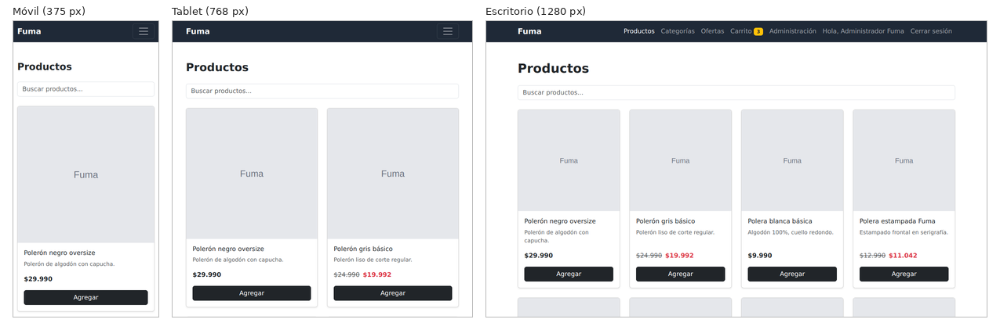
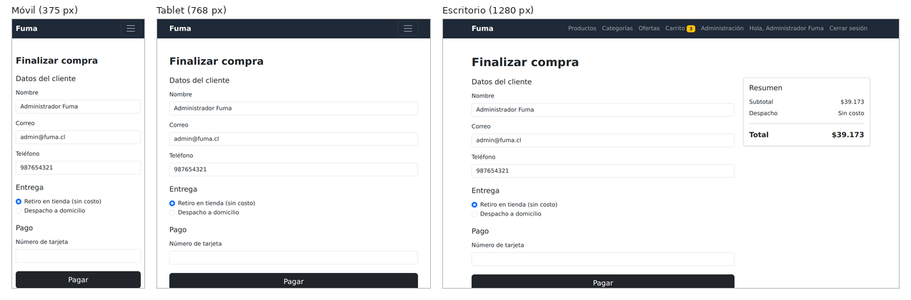

# 1. Objetivo del informe

Este informe explica **cómo se construyó el frontend de Fuma con React**: qué tecnologías se usaron y por qué, cómo está organizada la aplicación, cómo se manejan las propiedades (*props*) y el estado (*state*) en los componentes, y cómo se logró un diseño responsivo con Bootstrap. Complementa a dos documentos de la entrega:

- `docs/ERS-V2`: qué debe hacer el sistema (requisitos, modelo de datos, trazabilidad).
- `docs/Documento-Testing`: cómo se probó (93 pruebas unitarias, cobertura y análisis).

Todo lo que aquí se describe corresponde al código del repositorio. Los fragmentos de código son reales y se citan con el nombre del archivo.

# 2. Tecnologías y por qué se eligieron

| Tecnología | Versión | Para qué se usa en Fuma |
|---|---|---|
| React | 18.3.1 | Construir la interfaz con componentes reutilizables |
| Vite | 5.4.11 | Servidor de desarrollo y compilación (`npm run dev`, `npm run build`) |
| React Router | 6.28.0 | Navegar entre páginas sin recargar el navegador |
| Bootstrap | 5.3.3 | Diseño responsivo (solo su CSS) |
| Jasmine + Karma + Testing Library | 5.4.0 / 6.4.4 / 16.1.0 | Pruebas unitarias (ver `Documento-Testing`) |

**Por qué React.** El enunciado pide migrar las páginas HTML a componentes reutilizables que manejen sus propias propiedades y estado. React resuelve eso de forma directa: cada pieza de la pantalla es una función que recibe datos por *props* y devuelve JSX. Cuando cambia el estado, React vuelve a dibujar solo lo necesario.

**Por qué Vite.** Es la herramienta que arranca y compila el proyecto. Su configuración (`vite.config.js`) tiene una sola línea de interés: activar el plugin de React. No se usó nada más para mantener el proyecto simple.

**Por qué React Router.** La tienda tiene 15 rutas (catálogo, detalle, carrito, checkout, panel de administración, etc.). React Router permite declararlas en un solo lugar (`App.jsx`) y cambiar de página sin recargar.

**Bootstrap solo como CSS.** No se cargó el JavaScript de Bootstrap. El menú móvil, por ejemplo, lo controla React con estado (sección 5.4), no Bootstrap. Así no hay dos sistemas intentando manejar la misma pieza.

**Persistencia simulada.** No hay backend. Los datos se guardan en `localStorage` mediante un archivo de datos con operaciones CRUD (`src/data/baseDeDatos.js`), tal como pide el enunciado ("archivo JavaScript que actúe como fuente de datos simulada").

# 3. Cómo está organizada la aplicación

## 3.1 Carpetas

```
src/
├── main.jsx        arranque de la app (estilos, router y contextos)
├── App.jsx         tabla de rutas y layout general
├── components/     piezas reutilizables (17 componentes)
├── pages/          una página por ruta (13 páginas)
├── context/        estado global: carrito y sesión
├── data/           datos iniciales y CRUD sobre localStorage
├── utils/          lógica pura (precios, carrito, validaciones, filtros, pago)
├── styles/         variables de marca y estilos globales
└── tests/          pruebas (*.spec.js y *.spec.jsx)
```

La regla que ordena todo es que **cada archivo tiene una sola responsabilidad**:

- Un *componente* dibuja una pieza de la pantalla (por ejemplo, `TarjetaProducto`).
- Una *página* junta componentes para una ruta (por ejemplo, `PaginaProductos`).
- Un *contexto* guarda estado que necesitan muchas partes de la app (carrito y sesión).
- Un archivo de *utils* contiene cálculos sin React (por ejemplo, `calcularPrecioFinal`). Al no depender de React, se prueban directamente.
- `baseDeDatos.js` es el único archivo que lee y escribe productos y pedidos en `localStorage`.

## 3.2 Arranque y contextos

`main.jsx` envuelve la aplicación en tres capas:

```jsx
<BrowserRouter>
  <AuthProvider>
    <CarritoProvider>
      <App />
    </CarritoProvider>
  </AuthProvider>
</BrowserRouter>
```

- `BrowserRouter` habilita la navegación.
- `AuthProvider` comparte quién tiene la sesión iniciada (cliente, administrador o nadie).
- `CarritoProvider` comparte los productos del carrito.

Cualquier componente que esté dentro puede leer ese estado con los *hooks* `useAuth()` y `useCarrito()`, sin pasar datos de padre a hijo por muchos niveles.

## 3.3 Rutas

`App.jsx` dibuja la barra de navegación, el pie de página y, en medio, la página que corresponde a la ruta actual:

| Ruta | Página |
|---|---|
| `/` | Inicio |
| `/productos` | Catálogo con búsqueda |
| `/productos/:id` | Detalle de producto |
| `/categorias` y `/categorias/:idCategoria` | Productos por categoría |
| `/ofertas` | Productos con descuento |
| `/carrito` | Carrito |
| `/checkout` | Finalizar compra |
| `/compra-exitosa/:idPedido` y `/compra-fallida` | Resultado del pago |
| `/login` | Inicio de sesión |
| `/admin`, `/admin/productos/nuevo` y `/admin/productos/:id/editar` | Panel de administración |
| `*` | Página no encontrada (404) |

Las tres rutas de administración están envueltas en el componente `RutaAdmin`, que revisa `esAdmin` en el contexto de sesión. Si quien entra no es administrador, lo redirige a `/login` con `<Navigate>`.

# 4. Propiedades y estado en los componentes

## 4.1 La idea en pocas palabras

- **Props**: datos o funciones que un componente **recibe** de su padre. El componente no las modifica.
- **Estado** (`useState`): datos que un componente **guarda y puede cambiar**. Al cambiar, React vuelve a dibujar el componente.
- Un componente usa estado solo cuando lo necesita; si puede recibir todo por props, no tiene estado. Es lo que pide el enunciado ("maneje su propio estado solo cuando sea necesario").

Resumen de los cuatro componentes que se explican a continuación:

| Componente | Recibe (props) | Estado propio | Responsabilidad única |
|---|---|---|---|
| `TarjetaProducto` | `producto`, `onAgregarAlCarrito` | Ninguno | Mostrar un producto y avisar cuando se pulsa "Agregar" |
| `FormularioCheckout` | `datosIniciales`, `opcionEntrega`, `onCambiarEntrega`, `onConfirmar` | `datos`, `errores` | Capturar y validar los datos de compra |
| `BarraNavegacion` | `cantidadCarrito`, `usuario`, `onCerrarSesion` | `menuAbierto` | Mostrar el menú y abrirlo o cerrarlo en móvil |
| `CarritoProvider` | `children` | `items` | Guardar el carrito y compartirlo con toda la app |

## 4.2 `TarjetaProducto`: solo props, sin estado

Archivo: `src/components/TarjetaProducto.jsx`.

```jsx
export default function TarjetaProducto({ producto, onAgregarAlCarrito }) {
  return (
    <div className="card h-100 shadow-sm">
      
      <div className="card-body d-flex flex-column">
        <h2 className="h6 card-title">{producto.nombre}</h2>
        ...
        <button type="button" className="btn btn-dark" onClick={() => onAgregarAlCarrito(producto)}>
          Agregar
        </button>
```

Cómo funciona:

- Recibe el `producto` y dibuja nombre, descripción, imagen y precio. No guarda nada.
- Recibe una **función** `onAgregarAlCarrito`. La tarjeta no sabe qué hace esa función: solo la llama con el producto cuando se pulsa el botón.
- Por eso es **reutilizable**: la misma tarjeta sirve en el catálogo, en ofertas y en categorías. Cada página decide qué ocurre al agregar.

Quien le pasa los datos es `ListaProductos`, que recorre el arreglo de productos y dibuja una tarjeta por cada uno (`productos.map(...)`, con `key={producto.id}`). Si el arreglo está vacío, muestra un mensaje en lugar de tarjetas.

## 4.3 `FormularioCheckout`: estado local y props

Archivo: `src/components/FormularioCheckout.jsx`.

Tiene **dos estados** propios:

```jsx
const [datos, setDatos] = useState(() => ({ ...DATOS_VACIOS, ...datosIniciales }));
const [errores, setErrores] = useState({});
```

- `datos`: lo que el usuario escribe (nombre, correo, teléfono, dirección, tarjeta). Si hay sesión iniciada, parte con los datos del usuario (`datosIniciales`).
- `errores`: los mensajes de validación. Parte vacío.

Flujo al pulsar "Pagar":

1. `manejarEnvio` evita el envío normal del navegador (`evento.preventDefault()`).
2. Llama a `validarDatosCheckout` (en `src/utils/validaciones.js`), una **función pura** que devuelve un objeto con los errores.
3. Guarda esos errores en el estado, y React los muestra bajo cada campo.
4. Solo si no hay errores, llama a `onConfirmar(datos)`, la función que le entregó la página.

Dos decisiones de diseño que conviene saber explicar:

- **La opción de entrega no es estado del formulario**, sino de la página (`PaginaCheckout`): llega por props (`opcionEntrega`) y se cambia con `onCambiarEntrega`. Es porque esa opción también afecta el total del resumen, que está fuera del formulario. Cuando dos componentes necesitan el mismo dato, el estado se guarda en su padre común (*levantar el estado*).
- **La dirección solo aparece con despacho**: `{opcionEntrega === ENTREGA_DESPACHO && (<CampoFormulario ... />)}`. Es renderizado condicional.

Cada campo usa el componente reutilizable `CampoFormulario`, que recibe `etiqueta`, `nombre`, `valor`, `error` y `onCambiar`. Cuando `error` trae texto, agrega la clase `is-invalid` de Bootstrap y muestra el mensaje; si no, no muestra nada.

El formulario **no sabe** qué pasa después de confirmar. Quien crea el pedido es `PaginaCheckout`, en su función `finalizarCompra`: simula el pago, guarda el pedido sin el número de tarjeta, vacía el carrito y navega a `/compra-exitosa/:idPedido` (o a `/compra-fallida`).

## 4.4 `BarraNavegacion`: estado que controla un menú

Archivo: `src/components/BarraNavegacion.jsx`.

```jsx
const [menuAbierto, setMenuAbierto] = useState(false);
const claseColapso = menuAbierto ? "navbar-collapse collapse show" : "navbar-collapse collapse";
```

En pantallas pequeñas, el menú se muestra solo si `menuAbierto` es verdadero. El botón de la hamburguesa invierte ese valor, y al elegir una opción se cierra. Es React, y no el JavaScript de Bootstrap, quien agrega o quita la clase `show`.

También usa renderizado condicional según la sesión: si `usuario` es `null` muestra "Ingresar"; si hay usuario, muestra su nombre y "Cerrar sesión", y el enlace "Administración" solo si su rol es administrador.

## 4.5 `CarritoContext`: estado global compartido

Archivo: `src/context/CarritoContext.jsx`.

El carrito se necesita en varios lugares (la insignia del menú, el catálogo, la página del carrito, el checkout). En lugar de pasar el carrito por props entre muchos niveles, se guarda **una vez** en un proveedor:

```jsx
const [items, setItems] = useState(leerCarritoGuardado);

useEffect(() => {
  window.localStorage.setItem(CLAVE_CARRITO, JSON.stringify(items));
}, [items]);
```

- `useState(leerCarritoGuardado)`: al abrir la app, el carrito parte con lo que hubiera guardado (o vacío, si no hay nada o el dato está dañado).
- `useEffect`: cada vez que `items` cambia, lo guarda en `localStorage`. Por eso el carrito sobrevive a una recarga.
- Las acciones (`agregarAlCarrito`, `cambiarCantidadItem`, `eliminarDelCarrito`, `vaciarCarrito`) no modifican el arreglo: llaman a funciones puras de `src/utils/carrito.js`, que devuelven un arreglo **nuevo**. React detecta el cambio porque el arreglo es otro.
- `cantidadTotal` se calcula sumando las cantidades; es lo que muestra la insignia amarilla del menú.
- El hook `useCarrito()` entrega todo eso a quien lo pida, y lanza un error claro si se usa fuera del proveedor.

El contexto de sesión (`AuthContext`) sigue el mismo patrón: guarda `usuario`, lo persiste en `localStorage` y expone `iniciarSesion`, `cerrarSesion` y `esAdmin`.

## 4.6 Otros componentes del proyecto

Los 17 componentes siguen la misma idea. Algunos ejemplos:

| Componente | Qué hace |
|---|---|
| `SelectorCantidad` | Botones − y + que informan la nueva cantidad (no guarda estado) |
| `ItemCarrito` | Una fila del carrito: imagen, nombre, cantidad, subtotal y botón eliminar |
| `PrecioProducto` | Muestra el precio, o el precio tachado y el final si hay descuento |
| `FormularioProducto` | Formulario del panel de administración (crear y editar) con estado y validación |
| `TablaProductosAdmin` | Tabla del panel; pide confirmación antes de eliminar |
| `AlertaMensaje` | Mensaje de aviso reutilizable |
| `RutaAdmin` | Protege las páginas del administrador |

# 5. Diseño responsivo con Bootstrap

## 5.1 Qué significa "responsivo" aquí

La interfaz se adapta a tres anchos de referencia (requisito RNF-01 de la ERS): **móvil (375 px)**, **tablet (768 px)** y **escritorio (1280 px)**. Se logra con tres elementos: la etiqueta `viewport` de `index.html`, la grilla de Bootstrap y sus clases de visibilidad.

La etiqueta de `index.html` hace que el navegador móvil use el ancho real de la pantalla:

```html
<meta name="viewport" content="width=device-width, initial-scale=1.0" />
```

## 5.2 Técnicas usadas, con su lugar en el código

| Técnica | Clases de Bootstrap | Dónde |
|---|---|---|
| Contenedor centrado con márgenes | `container`, `py-5` | Todas las páginas |
| Grilla de productos que cambia de columnas | `row row-cols-1 row-cols-sm-2 row-cols-lg-4 g-4` | `ListaProductos` |
| Checkout en dos zonas | `col-lg-8` (formulario) y `col-lg-4` (resumen) | `PaginaCheckout` |
| Detalle en dos columnas | `col-md-6` y `col-md-6` | `PaginaDetalleProducto` |
| Menú que se colapsa | `navbar-expand-lg`, `navbar-toggler`, `collapse` | `BarraNavegacion` |
| Columnas de tabla que se ocultan | `d-none d-md-table-cell`, `d-none d-sm-table-cell` | `TablaProductosAdmin` |
| Tabla con desplazamiento lateral | `table-responsive` | `TablaProductosAdmin` |
| Formularios con errores | `form-control`, `is-invalid`, `invalid-feedback` | `CampoFormulario` |

Cómo se lee la grilla del catálogo: `row-cols-1` significa una columna en móvil; `row-cols-sm-2`, dos columnas desde pantallas pequeñas; `row-cols-lg-4`, cuatro columnas desde pantallas grandes. Es decir, el mismo componente `ListaProductos` produce una, dos o cuatro columnas según el ancho.

## 5.3 Estilo propio

Bootstrap cubre casi todo. Solo hay estilos propios donde hacía falta:

- `src/styles/variables.css`: los dos colores de marca (`--fuma-color-principal` y `--fuma-color-acento`).
- `src/styles/global.css`: color de la barra y el pie, y la clase `.imagen-producto`. Las fotos de los productos tienen proporciones distintas, así que se les da un recuadro cuadrado (`aspect-ratio: 1 / 1`) con `object-fit: cover`. Así todas las tarjetas quedan del mismo tamaño.

## 5.4 Ejemplos en tres dispositivos

Las capturas están en `docs/capturas/` (8 vistas × 3 anchos = 24 imágenes). Se muestran dos vistas representativas, recortadas a la misma altura para compararlas (`comparacion-productos.png` y `comparacion-checkout.png`).

**Catálogo de productos** (`/productos`): una columna en móvil, dos en tablet y cuatro en escritorio. En móvil, el menú queda detrás del botón de hamburguesa.

{width=16cm}

**Checkout** (`/checkout`): en móvil el resumen del pedido queda debajo del formulario; desde pantallas grandes se ubica a su lado (`col-lg-8` y `col-lg-4`).

{width=16cm}

*Nota:* estas capturas se tomaron antes de agregar las fotos de los productos, por eso las tarjetas muestran la imagen genérica "Fuma". El diseño responsivo es el mismo. Las capturas del resto de las vistas (inicio, detalle, carrito, login y panel de administración) están en la misma carpeta.

# 6. Cómo se conecta todo

## 6.1 Capas de la aplicación

```
Página (pages/)
 ├─ pasa props ───────────► Componentes (components/)
 ├─ useCarrito / useAuth ─► Contextos (context/)
 │                            ├─► utils/ (funciones puras)
 │                            └─► localStorage (carrito, sesión)
 ├─ llama a ──────────────► data/baseDeDatos.js
 │                            └─► localStorage (productos, pedidos)
 └─ calcula con ──────────► utils/ (precios, validaciones, pago)
```

Cuatro claves de `localStorage`:

| Clave | Contenido | Quién la escribe |
|---|---|---|
| `fuma_productos` | Catálogo de productos | `baseDeDatos.js` (CRUD del administrador) |
| `fuma_pedidos` | Pedidos aprobados | `baseDeDatos.js` (al finalizar una compra) |
| `fuma_carrito` | Ítems del carrito | `CarritoProvider` |
| `fuma_sesion` | Usuario con sesión iniciada | `AuthProvider` |

Los productos y pedidos se crean con datos iniciales (`datosIniciales.js`) **solo si la clave aún no existe** en `localStorage`. Por eso, para volver a los datos de fábrica se ejecuta `localStorage.clear()` y se recarga la página.

## 6.2 Ejemplo: agregar un producto al carrito

1. En `/productos`, `PaginaProductos` lee los productos con `obtenerProductos()` (una sola vez, al abrir la página) y los filtra por texto con `filtrarPorTexto`.
2. Se los entrega a `ListaProductos`, que dibuja una `TarjetaProducto` por producto y le pasa `agregarAlCarrito` (tomada de `useCarrito()`).
3. El usuario pulsa **Agregar**. La tarjeta llama `onAgregarAlCarrito(producto)`.
4. `CarritoProvider` ejecuta `setItems(...)` con la función pura `agregarItem`: si el producto ya está, suma 1 a la cantidad; si no, lo agrega con su precio final.
5. Cambió el estado, así que React vuelve a dibujar lo que lo usa: la insignia de `BarraNavegacion` (por `cantidadTotal`) y las páginas que muestran el carrito.
6. El `useEffect` guarda el nuevo carrito en `localStorage`.

## 6.3 Ejemplo: comprar

1. `/carrito` muestra los ítems; cada `ItemCarrito` usa `SelectorCantidad` para cambiar la cantidad.
2. `/checkout`: si hay sesión iniciada, el formulario se precarga con los datos del usuario. Si el carrito está vacío, muestra un aviso en lugar del formulario.
3. `FormularioCheckout` valida; si todo está bien, llama a `finalizarCompra` en `PaginaCheckout`.
4. `finalizarCompra` evalúa el pago con `pagoEsAprobado` (utils/pago.js). Si es rechazado, navega a `/compra-fallida`.
5. Si es aprobado, `crearPedido` guarda el pedido (sin el número de tarjeta), `vaciarCarrito` limpia el carrito y se navega a `/compra-exitosa/:idPedido`, que lee el pedido y muestra el resumen.

## 6.4 Ejemplo: administración

`/admin` (protegida por `RutaAdmin`) lista los productos con `TablaProductosAdmin`. Crear y editar usan `FormularioProducto` con `validarProducto`; eliminar pide confirmación con `window.confirm`. Cada operación llama a `crearProducto`, `actualizarProducto` o `eliminarProducto` de `baseDeDatos.js`, que escriben en `localStorage`. Los productos nuevos usan una imagen genérica porque el sistema no incluye carga de imágenes (supuesto S-03 de la ERS).

# 7. Relación con las pruebas

Cada elemento descrito arriba tiene pruebas unitarias (93 en 17 archivos, todas en verde; cobertura de líneas 95,85 %). El detalle está en `Documento-Testing`. Ejemplos directos:

| Elemento | Prueba real (nombre en `src/tests/`) |
|---|---|
| `TarjetaProducto` (props y función recibida) | "llama a onAgregarAlCarrito con el producto al pulsar Agregar" |
| `ListaProductos` (renderizado de lista) | "renderiza una tarjeta por cada producto" |
| `FormularioCheckout` (estado y validación) | "muestra errores y no confirma cuando el formulario está vacío" · "actualiza el campo nombre al escribir" |
| `BarraNavegacion` (estado del menú) | "abre y cierra el menú al hacer clic en el botón" |
| `CarritoProvider` (contexto y persistencia) | "aumenta el contador al agregar un producto" · "guarda el carrito en localStorage al agregar un producto" |
| `PaginaCheckout` (flujo completo) | "crea el pedido, vacía el carrito y muestra la compra exitosa" |

# 8. Relación con la ERS y con la rúbrica

| Indicador de la rúbrica | Dónde se evidencia |
|---|---|
| IE2.1.1 Proyecto con framework JavaScript bien estructurado | Secciones 2 y 3 de este informe; ERS secciones 2 y 9 |
| IE2.1.2 Componentes React con props, estado y diseño responsivo (Bootstrap) | Secciones 4 y 5 de este informe; ERS RNF-01 y RNF-02 |
| IE2.2.1 Pruebas unitarias de componentes frontend con Jasmine y Karma | `Documento-Testing`, secciones 5 a 8; sección 7 de este informe |
| IE2.3.1 Proceso de testeo (configuración, mocks, cobertura) | `Documento-Testing`, secciones 4, 8, 9 y 10 |

# 9. Limitaciones conocidas

Para ser transparentes sobre el alcance real:

- **No hay backend.** Los datos viven en el navegador (`localStorage`); cada navegador tiene los suyos. Es una simulación académica, tal como lo declara la ERS.
- **Las contraseñas de los usuarios de prueba están en texto plano** en `datosIniciales.js`, solo porque es una simulación sin servidor.
- **El pago es simulado**: una tarjeta de 16 dígitos que empieza con `0000` se rechaza; cualquier otra válida se aprueba.
- **Los productos nuevos usan una imagen genérica**, porque no hay carga de imágenes (S-03).
- **Los productos del catálogo se leen una sola vez al abrir la página**, no se actualizan en vivo si cambian desde otra pestaña.
- **Las capturas de la sección 5.4 muestran la imagen genérica**, porque se tomaron antes de agregar las fotos.
- **Pruebas manuales y detalle de cobertura**: ver `Documento-Testing`, secciones 12 y 14.

# 10. Preguntas probables y cómo responderlas

Las respuestas se basan en el código descrito en este informe.

**¿Qué diferencia hay entre props y estado?**
Las props las recibe un componente desde su padre y no las modifica; el estado lo guarda el propio componente con `useState` y, al cambiarlo, React vuelve a dibujar. Ejemplo: `TarjetaProducto` solo recibe props; `FormularioCheckout` además guarda `datos` y `errores`.

**¿Por qué `TarjetaProducto` no tiene estado?**
Porque todo lo que necesita lo recibe: el producto y la función a llamar al agregar. Así se reutiliza en catálogo, ofertas y categorías sin cambiar nada.

**¿Para qué sirve el contexto del carrito? ¿Por qué no pasar el carrito por props?**
El carrito se usa en la barra de navegación, el catálogo, la página del carrito y el checkout. Con contexto se guarda una sola vez en `CarritoProvider` y cualquiera lo lee con `useCarrito()`, sin pasar datos por muchos niveles.

**¿Cómo se mantiene el carrito al recargar la página?**
`CarritoProvider` inicia el estado leyendo `localStorage` y un `useEffect` lo vuelve a guardar cada vez que `items` cambia.

**¿Por qué las funciones del carrito devuelven un arreglo nuevo?**
React detecta que el estado cambió cuando recibe un valor distinto. Si se modificara el arreglo original, podría no redibujar. Además, al ser funciones puras, se prueban sin React.

**¿Cómo aplicaron el diseño responsivo?**
Con el `viewport` de `index.html` y la grilla de Bootstrap: por ejemplo `row-cols-1 row-cols-sm-2 row-cols-lg-4` hace que el catálogo tenga una, dos o cuatro columnas. También `navbar-expand-lg` para el menú, `col-lg-8`/`col-lg-4` en el checkout y `d-none d-md-table-cell` para ocultar columnas de la tabla del administrador.

**¿Por qué el menú móvil lo controla React y no Bootstrap?**
Porque no se cargó el JavaScript de Bootstrap. `BarraNavegacion` guarda `menuAbierto` y agrega la clase `show` según ese estado; así hay un solo responsable del menú.

**¿Cómo funciona la validación del formulario de checkout?**
Al enviar, `validarDatosCheckout` (función pura) devuelve un objeto con los errores. Se guardan en el estado `errores` y cada `CampoFormulario` muestra el suyo con `is-invalid`. Solo si no hay errores se llama a `onConfirmar`.

**¿Cómo protegieron el panel de administración?**
Con `RutaAdmin`: lee `esAdmin` del contexto de sesión y, si es falso, redirige a `/login` con `<Navigate>`. Es una protección de la interfaz; al no haber backend, no es seguridad real, y así lo declara la ERS.

**¿Dónde se guardan los datos si no hay backend?**
En `localStorage`, a través de `src/data/baseDeDatos.js`, que ofrece el CRUD de productos y el alta y consulta de pedidos. Si la clave no existe, se crea con los datos iniciales.

**¿Por qué React + Vite y no HTML con JavaScript?**
Porque el enunciado pide componentes reutilizables con props y estado. React los da de forma directa y Vite aporta el servidor de desarrollo y la compilación con muy poca configuración.

**¿Qué cambió en el proyecto respecto a la plantilla HTML?**
Cada vista HTML se convirtió en una página con componentes reutilizables, la navegación pasó a React Router, el carrito (que estaba en JavaScript) pasó a un contexto con persistencia, se agregaron las vistas pedidas (categorías, ofertas, checkout, compra exitosa y fallida, panel de administración) y se escribieron las pruebas unitarias.
